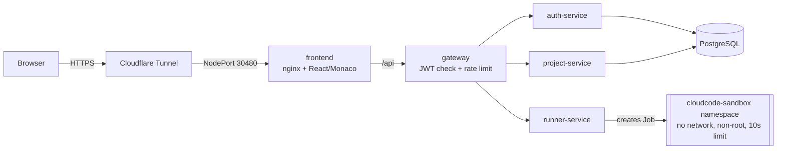

# ⚡ CloudCode IDE

A browser-based IDE: sign up, create projects, edit code in Monaco (the VS Code editor) and run it
instantly. Every run executes in an **isolated, network-less Kubernetes Job**.

**Live:** https://ide.poorabsharma.site

Built for *Cloud Native Applications & DevOps*.

## Architecture



| Service | Responsibility |
|---|---|
| `frontend` | React + Monaco UI, served by unprivileged nginx, proxies `/api` |
| `gateway` | Single API entry. Verifies JWTs, injects the trusted `x-user-id`, rate limits |
| `auth-service` | Registration / login (bcrypt, JWT) |
| `project-service` | Projects and files CRUD, per-user ownership |
| `runner-service` | Turns a run request into a hardened Kubernetes Job and returns its logs |
| `postgres` | StatefulSet with a persistent volume |

## How the course topics map to the repo

| Topic | Where |
|---|---|
| Microservices | `services/*` – five independently built and deployed services |
| Docker | `services/*/Dockerfile` (multi-stage, non-root, healthchecks), `docker-compose.yml` |
| Kubernetes | `k8s/` – Kustomize base + prod overlay, HPA, RBAC, NetworkPolicies, quotas |
| CI/CD | `.github/workflows/ci.yml`, `cd.yml` – test → build → scan → push to GHCR → deploy via self-hosted runner |
| DevSecOps | `.github/workflows/security.yml` (Gitleaks, Semgrep, Trivy, npm audit, hadolint), Dependabot, Pod Security `restricted` sandbox, deny-all NetworkPolicy |
| Local machine | Deployed on a home server running k3s |
| Public link | https://ide.poorabsharma.site through a Cloudflare Tunnel |

## Run locally

```bash
docker compose up --build
open http://localhost:3000
```
(Compose uses `RUNNER_MODE=local`, which runs code inside the runner container – development only.)

Run a service's tests: `cd services/<name> && npm ci && npm test`.

## Sandbox security model

Untrusted code runs as a Kubernetes Job in the `cloudcode-sandbox` namespace:

- Pod Security Standard **restricted** is enforced on the namespace
- non-root UID, read-only root filesystem, all capabilities dropped, seccomp `RuntimeDefault`
- `deny-all` NetworkPolicy (no ingress, no egress, no DNS)
- CPU / memory / ephemeral-storage limits, namespace `ResourceQuota`
- `activeDeadlineSeconds: 10` hard timeout, auto-cleanup via TTL
- no service-account token mounted; user code reaches the container only as a base64 env var (never interpolated into a shell string)

## Delivery pipeline

```
PR  ──► CI (lint, tests, docker build, manifest validation) + Security scans ──► review by teammate ──► merge
main ──► CI + Security ──► build images ──► Trivy image scan ──► push to GHCR ──► self-hosted runner: kubectl apply -k ──► smoke test
```

`main` is protected: changes land through pull requests that are reviewed and approved by the other maintainer.

## Team

| | Main areas |
|---|---|
| [@poorabsharma5](https://github.com/poorabsharma5) | gateway, auth-service, frontend, Dockerfiles / compose, Kubernetes base, CD |
| [@pruthaaaaa](https://github.com/pruthaaaaa) | project-service, runner-service & sandbox hardening, CI, security pipeline, NetworkPolicies / HPA |

## Verified in production

End-to-end checks against https://ide.poorabsharma.site after the first successful deploy:

| Check | Result |
|---|---|
| Register / login, JWT on every API call | works, requests without a token get `401` |
| Run Python / JavaScript / C++ | works, ~4-5 s warm |
| Infinite loop | killed at the 10 s deadline (`timeout`) |
| Outbound network from user code | blocked (`URLError`) |
| Write to root filesystem | blocked (`OSError`, read-only) |
| Process user | `uid 10001` (non-root) |

## Lessons from the pipeline

The gates did real work on the first runs:

- **npm audit** caught an unpatched `braces` advisory pulled in by `http-proxy-middleware` -> replaced the proxy with ~20 lines of `node:http`.
- **Semgrep** caught a root, writable-filesystem Postgres pod and hardcoded test secrets.
- **Trivy (image scan)** blocked images twice: a CRITICAL `node-tar` bundled in npm of the Node base image, and a CRITICAL OpenSSL in the nginx base image.
- The Kubernetes `runAsNonRoot` check rejected a named user (`USER node`), so manifests pin a numeric UID.

Each fix went through a pull request; see the closed PRs for the history.
